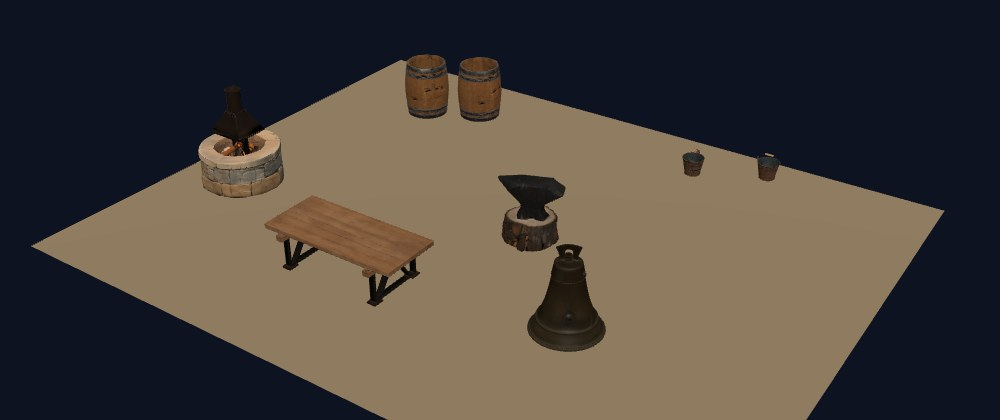

# Scenes: layout, then assets

A scene from a sentence, on your own GPU, with no hosted service. `Examples/09.SceneGen.Console` is the shell; the pieces are in `SpawnDev.ILGPU.ML.Assets`.



```bash
dotnet run --project Examples/09.SceneGen.Console -- "a blacksmith's workshop" --out workshop        # LLM layout, 6 assets, one scene
dotnet run --project Examples/09.SceneGen.Console -- "a blacksmith's workshop" --plan-only           # just the layout: edit workshop_layout.json, then
dotnet run --project Examples/09.SceneGen.Console -- --layout workshop_layout.json --out workshop    # build the layout you edited
```

## How it works

1. **`SceneLayoutPlanner`** asks a local LLM (an Ollama model name such as `qwen3:14b`, or a `.gguf` file; any `GgufTextGenerationPipeline`) for a **`SceneLayout`** as JSON: a ground, and objects with a prompt for ONE object alone, a height in metres and one or more instances (x, z, rotation, scale). The answer is parsed tolerantly (code fences, prose, a reasoning model's think block, trailing commas, numbers as strings), clamped to sane limits, and when it is unusable the model is asked again with the reason (up to 3 tries).
2. The LLM is freed. **`SceneGenerator`** generates every DISTINCT object once with `AssetGenerator` (FLUX.2 klein picture, RMBG-1.4 cut-out, TRELLIS.2 3D; 80k triangles and a 1024 px texture per object by default): repeated objects (four barrels) cost one generation.
3. **`GltfSceneComposer`** writes ONE glTF: each asset copied in once (meshes, materials, textures, images, buffers re-indexed), one node per instance, scaled so the asset is as tall as the layout says, stood on the ground (lowest point at y = 0, centred on its own footprint), turned about the vertical axis; plus a flat ground quad of the layout's size and colour. The layout rides along in the scene's `extras`.

Units are metres, Y is up, the ground is the plane y = 0 centred on the origin, x runs right and z toward the viewer.

## Measured (RTX 4070, CUDA, models cached)

- Layout: `qwen3:14b` 42 s, `gemma4:12b` 183 s (with the library's fast LLM kernels switched on by the example, as Example 06 does; they are off by default). Both gave six sensible kinds of object; the first prompts told the LLM to describe one object alone and still let "a hammer resting on a workbench" through, which draws both, so the system prompt now says an object must not mention another object or surface and nothing is placed on top of anything.
- Scene: six objects (forge, bench, anvil on a stump, bellows, 2 barrels, 2 buckets), 8 placements, **8.7 minutes**, 36 MB GLB. About 1.5 minutes per distinct object.
- Honest limits: the picture model drew a church bell for "a large leather bellows with iron fittings" (a prompt it did not understand; nothing checks the picture against the prompt); the LLM lays objects out sparsely and cannot stack or attach things (no "on the bench"); the demo's built-in glTF viewer shows one mesh, so view a scene in any glTF viewer (Blender, Windows 3D Viewer, three.js).

## What is not here yet

Stacking and support relations, rooms and walls, terrain, streaming and level of detail for large worlds, collision proxies, an interactive editor. Those belong to the engine (SpawnDarkly) and the demo, not to this library; see [../Plans/scene-generation-and-3d-editing-research.md](../Plans/scene-generation-and-3d-editing-research.md). Native scene-generation models are compared against this layout-then-assets baseline there.

Tests: `SceneLayout_*`, `SceneLayoutPlanner_*` (fake LLM, retry with the reason), `GltfSceneComposer_*` (instances stored once, world-space boxes on the ground), CPU, no GPU or model needed.
