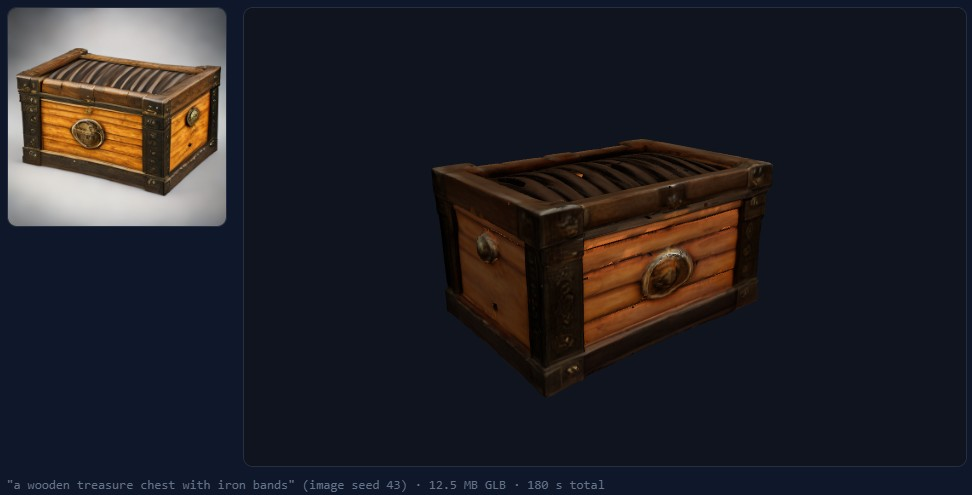

# TRELLIS.2: image and text to 3D, on the desktop and in the browser

`SpawnDev.ILGPU.ML.Trellis2` runs [TRELLIS.2](https://github.com/microsoft/TRELLIS.2) (Microsoft, MIT) end to end in C#: a photo, or a
text prompt, becomes a textured PBR 3D model (GLB: positions, normals, UVs, base colour and metallic-roughness textures). Every
network stage runs as SpawnDev.ILGPU kernels, so the same code runs on CUDA (tensor cores), OpenCL, CPU and **in the browser on
WebGPU**. To our knowledge the demo page is the first fully client-side TRELLIS.2 on the web: no server, no upload, the model
weights stream into the browser and everything runs on the visitor's GPU.

**Try it:** [lostbeard.github.io/SpawnDev.ILGPU.ML/text-to-3d](https://lostbeard.github.io/SpawnDev.ILGPU.ML/text-to-3d)
(`/image-to-3d` opens the photo mode).



## What runs

| Stage | What | Where it runs |
|-------|------|---------------|
| Text to image (text mode) | SD Turbo (`ImageGenerationPipeline`), retried with the next seed when the cut-out touches the frame (a cropped drawing becomes a truncated model) | GPU |
| Cut-out | RMBG-1.4 in the demo (`BackgroundRemovalPipeline`); desktop `Trellis2TextTo3D` uses IS-Net (`ForegroundMask`) | GPU |
| Conditioning | DINOv3 ViT-L/16 features of the 512 px image | GPU |
| Sparse structure | 1.3B flow transformer (12 Euler steps, classifier-free guidance) + structure decoder -> occupied cells | GPU |
| Shape | 1.3B shape flow on the sparse voxels + SC-VAE decoder -> FlexiDualGrid mesh (1-3M triangles) | GPU |
| Texture | 1.3B texture flow + SC-VAE decoder -> PBR attributes per voxel | GPU |
| Mesh repair | `MeshRepair` on the dual-grid mesh: non-manifold edges, winding, small holes, floating fragments | host |
| Remesh | `NarrowBandRemesher` (the reference's `to_glb(remesh=True)`): the distance field of the mesh (`MeshDistanceGrid`, on the device) shifted one voxel, extracted by dual contouring on the voxels the band crosses. Closes pinholes and cracks, turns a thin plate into one watertight outward-facing skin; the skin inside a closed solid is dropped | GPU distances, host topology |
| Mesh | quadric edge collapse (`MeshSimplifier`) to 300k triangles, then `MeshRepair` again | host |
| UV atlas + bake | `UvAtlas` charts and packs; `TextureBaker` rasterises the atlas, moves every texel onto the nearest point of the ORIGINAL (pre-remesh) mesh (`MeshDistanceGrid.ProjectTexels`, the reference's `bvh.unsigned_distance`) and samples the voxel attributes there, so the colour is read exactly on the surface the decoder painted | host, then GPU |
| GLB | PNG encode + `PbrGlbWriter` | host |

Every network stage was gated against the reference implementation's own classes (CPU torch goldens, `tools/trellis2-harness`).

## Performance (MEASURED, RTX 4070 12 GB)

| Where | Path | Time |
|-------|------|------|
| Desktop, CUDA | photo -> GLB, 512 pipeline (tensor-core GEMM + flash attention, inline PTX) | ~40 s, 3 GB peak |
| Desktop, CUDA | 1024 pipeline (`Trellis2Options.Resolution = 1024`) | plant 73 s, crown 141 s, 3.6 GB |
| Desktop, OpenCL | photo -> GLB (portable kernels) | ~83 s |
| Browser, WebGPU (Chrome, AOT build) | photo -> GLB, weights cached in OPFS, fresh page | 148 s |
| Browser, WebGPU | same, next generation in the session | 134 s |
| Browser, WebGPU | text -> GLB, everything cached | 180 s |
| Browser, WebGPU | text -> GLB (SD Turbo first download included) | 246 s |
| Browser, WebGPU | first ever run (10 GB of weights to download) | a few more minutes, bound by the download |

In the browser almost all of the remaining time is the three flow transformers on the GPU (~97 s of 134 s): the portable kernels reach
~8 TFLOPS (tiled GEMM) and ~5.6 TFLOPS (flash attention) on WebGPU, where CUDA uses tensor cores.

## How the browser version fits

- **Portable kernels.** WebGPU has no tensor cores and no inline assembly: a register-tiled GEMM (one kernel for bf16 / f16 weights and
  dense / gathered rows) and a flash attention (8 lanes x 4 queries per thread, warp shuffles) carry every transformer and sparse
  convolution. Generated by `tools/trellis2-harness/reference/gen_tiled_gemm.py` / `gen_tiled_attention.py`.
- **10 GB of weights.** `Trellis2Weights.FromModelSource` reads checkpoints one stage at a time from any `IModelSource`.
  `RangeStreamModelSource.PlanCacheAsync` caches the files in OPFS and streams only what the browser has no room for, with range
  requests (`FetchRangeStream`: four requests in flight, bytes go JS -> GPU without entering the .NET heap). The quota from
  `navigator.storage.estimate()` is not a limit: Chrome 151 reports `usage + 10 GiB` however much it would take (14 GiB written against a
  10 GiB "quota"), so only an exact headroom bounds the plan (`BrowserStorageEstimate`) and a write the browser really refuses falls back to
  streaming that file (`CacheFallback`).
- **Shader compilation.** The browser compiles a WebGPU shader at its first launch, one at a time with the queue waiting (seconds each
  for these kernels). `WebGPUAccelerator.PrecompileAsync` (SpawnDev.ILGPU 5.3.8) builds the large kernels' pipelines in the background
  and in parallel at the start of a generation.
- **Host work.** The demo is published with Blazor WebAssembly AOT (`-p:DemoAot=true`): the mesh simplification and UV atlas are
  30-45x slower in the interpreter (41 s -> 2.6 s and 17 s -> 0.8 s measured).
- **Mesh size.** The 3M-triangle dual-grid mesh is clustered on the device first (O(n)), so the sequential edge collapse only does the
  last step.

## API

Desktop, local checkpoint files:

```csharp
using SpawnDev.ILGPU.ML.Trellis2;

using var gen = new Trellis2ImageTo3D(accelerator, new Trellis2Paths
{
    ModelDir = @"...\TRELLIS.2-4B",
    SparseStructureDecoder = @"...\TRELLIS-image-large\ckpts\ss_dec_conv3d_16l8_fp16",
    DinoWeights = @"...\dinov3\model.safetensors",
});
byte[] glb = await gen.GenerateGlbAsync(rgbaPixels, width, height,   // RGBA, alpha = foreground
    new Trellis2Options { Seed = 42, MaxFaces = 150_000, TextureSize = 2048 });
```

Text to 3D on the desktop: `new Trellis2TextTo3D(accelerator, paths, imageModelSource, isnetOnnxPath).GenerateGlbAsync(prompt)`.

Browser (or any `IModelSource`): weights from the hub, cached where they fit, streamed otherwise:

```csharp
var ranged = new RangeStreamModelSource(hubModelSource);          // a HubModelSource constructed with an HttpClient
await ranged.PlanCacheAsync(Trellis2Weights.HubWeightFiles(), await hubModelSource.GetStorageEstimateAsync());
using var gen = new Trellis2ImageTo3D(accelerator, Trellis2Weights.FromModelSource(ranged));
byte[] glb = await gen.GenerateGlbAsync(rgbaPixels, width, height);  // StageDone reports each stage and its seconds
```

The demo page (`SpawnDev.ILGPU.ML.Demo/Pages/Image3DPage.razor`) shows the whole flow, including SD Turbo + RMBG-1.4 for text mode.

## Tests

`Trellis2_TiledLinear_MatchesHostReference`, `Trellis2_TiledSparseConv_MatchesHostReference`, `Trellis2_FlashAttention_MatchesHostReference`
and `Trellis2_MeshClusterer_SphereStaysOnSurface` run the portable kernels against host double references on WebGPU, CUDA, OpenCL and
CPU; `Remesh_*` (distance grid against a brute-force oracle, the remesh of a sphere, a pinhole and a thin double sheet, the projection) run on CUDA and OpenCL; `Trellis2_UvAtlas_*`, `Trellis2_MeshSimplifier_*`, `Trellis2_PbrGlb_*` cover the host stages; `Trellis2_ImageToGlb_EndToEnd`
(HeavyModel) runs the real model. `Trellis2_DiTKernels_Benchmark` / `Trellis2_KernelCompile_Benchmark` (HeavyModel) measure throughput
and shader compile cost.

## Next step: rig it

A generated character can be given a skeleton and learned skin weights with `SkinTokensRigger` (and the demo's **Rig this model** button): see [rigging.md](rigging.md).

## Licences

TRELLIS.2 code and weights: MIT. DINOv3 weights: Meta's DINOv3 licence ("Built with DINOv3"). SD Turbo: Stability AI's licence.
RMBG-1.4: BRIA's licence. Weights are not shipped in the package; the demo downloads them from the Hugging Face hub (through the
SpawnDev hub proxy) on first use. Check each licence before commercial use.

## Why the remesh (measured)

Without it the generated mesh is the raw dual-grid mesh, simplified. A thin plate of armour is two surfaces one voxel apart, and the texture decoder paints the inner one near black; the raw mesh also has voxel-sized pinholes. Baking colour at the simplified mesh's own positions lets that dark inner layer show through wherever the surface sits a little deep, and the pinholes show it directly: a knight came out with dozens of black dots (the "holes"). Measured on that knight: 964 hole loops longer than the hole-fill limit, 34% of the texture voxels near black, 15k dark islands in the baked colour, and none of the cheaper fixes (recolouring voxels, filling texture islands, smoothing normals, flipping triangles) removed the dots. The reference does not have the problem because `to_glb(remesh=True)` rebuilds the surface and reads colour from the original; this is that, ported (`Trellis2Options.Remesh`, default on).

## Editing a region of a generated asset (prototype, 2026-10-19)

`Trellis2Pipeline.RetextureRegionAsync` / `Trellis2ImageTo3D.EditRegionAsync` / `AssetGenerator.EditRegionAsync` re-texture part of a generated asset from a new picture and keep the rest. Training-free, RePaint style: every generation now keeps its structured latents (`Output.Edit`, a few MB on the host). The edit runs the texture flow again, conditioned on the SAME shape latent (so the geometry cannot change) and the new picture's DINOv3 features, and after every Euler step puts the tokens OUTSIDE the region back to the original texture latent noised to the current time (`x_t = (1 - t) x0 + (sigma + (1 - sigma) t) eps`, the flow's own path; `FlowSampler.Sample` has an `afterStep` hook for it). The region is a predicate on a token's centre in the generator's frame (x right, y depth, z up, volume [-0.5, 0.5]^3); `AssetGenerator.RegionFromSpec("z>0.08")`, `box:...`, `sphere:...` and unions make them from text; the console takes `--edit-picture p.png --edit-region "z>0.08"`.

Measured on the knight (CUDA, 512 pipeline, 1193 tokens): upper body (480 tokens) re-textured from a red-armour picture in ~20 s on top of the generation (DINOv3 3.6 s, shape decode 2.8 s, texture flow 1.8 s, texture decode 2.7 s): red enamel and gold trim on head, chest and shoulders, legs and gauntlets still silver, no seam at the cut. Test `Trellis2_RegionRetexture_KeepsTheRestAndChangesTheRegion` (real model, 5553 tokens): voxels far outside the region change by at most 0.0025, voxels inside by 0.74 on average.

Not done: editing the SHAPE (needs the shape flow under the mask as well), editing an arbitrary mesh (needs the shape and texture ENCODERS, which TRELLIS.2 ships: `shape_enc_next_dc_f16c32_fp16`, `tex_enc_next_dc_f16c32_fp16`), inversion-based preservation (VoxHammer) for harder edits, a text prompt instead of a picture, any UI.
